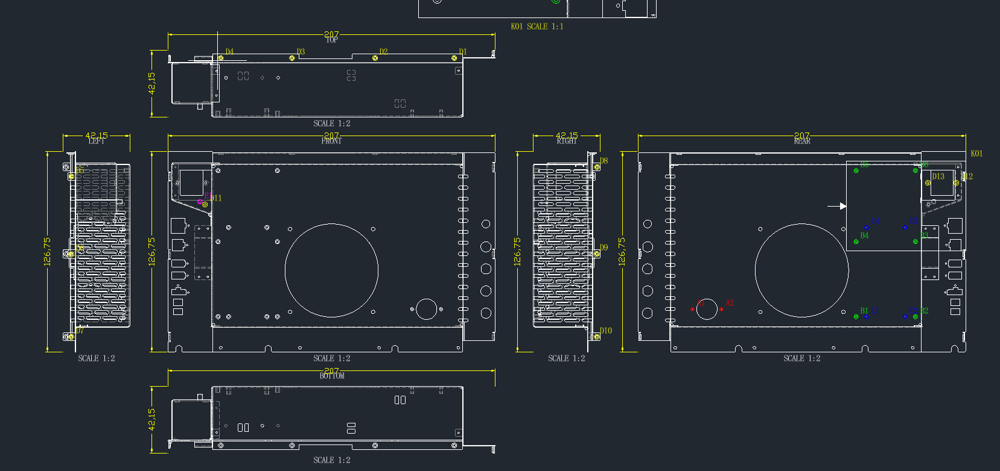

# freecad-sheetmetal-drawing Skill

使用 FreeCAD 将 STEP/STP 钣金总成生成同一图幅的六面正投影可编辑 DXF，并完成尺寸、压铆柱分类、图幅排版和交付验收。

制图规则和验收条件以 [SKILL.md](SKILL.md) 及其按阶段引用的 `references/` 为准；本 README 只简要说明工具链、安装和使用方法。

## 工具链

| 工具/组件                           | 用途                                                                        | 要求                                                                                                |
| ----------------------------------- | --------------------------------------------------------------------------- | --------------------------------------------------------------------------------------------------- |
| Codex + 本 Skill                    | 读取项目输入，选择专项规则，组织出图、回读和验收                            | Skill 提供规则与审计工具；项目可使用独立的 STEP→DXF 生成脚本                                        |
| FreeCAD / `FreeCADCmd`              | 导入并重算 STEP，读取装配和实体拓扑，取得标准视向，执行 TechDraw HLR 正投影 | 调用 FreeCAD API 的脚本必须能导入 `FreeCAD`、`Part` 和 `TechDraw`；当前 HLR 分组按 FreeCAD 1.1 验证 |
| FreeCAD 自带 Python                 | 无界面运行几何生成、STEP 特征审计和连续闭环                                 | Windows 通常位于 FreeCAD 安装目录的 `bin/python.exe`                                                |
| Python 3                            | 运行 DXF 后处理及不依赖 FreeCAD API 的辅助程序                              | Python 与扩展包版本必须兼容                                                                         |
| `ezdxf`                             | 创建、编辑并重新读取 DXF，检查图层、线型、线宽、颜色、字体、实体和块        | 最终验收必须重新读取已关闭的最终 DXF                                                                |
| Matplotlib + `ezdxf.addons.drawing` | 从最终 DXF 生成高分辨率 PNG 回读预览                                        | 使用 `Agg` 等非交互后端；预览不是 FreeCAD 截图                                                      |
| 工程字体                            | 显示中文、数字和工程符号                                                    | 项目/加工厂字体优先；本项目 Windows 默认使用可解析的 `simfang.ttf`                                  |
| 目标 CAD 阅读器                     | 验证 DXF 的实际显示、打印和交互性能                                         | 使用加工厂指定或项目常用 CAD 完成打开、缩放、图层、打印预览和保存副本测试                           |

### 环境检查

开始任务前至少确认以下工具可调用：

```powershell
FreeCADCmd --version

& "<FreeCAD安装目录>\bin\python.exe" -X utf8 -c `
  "import FreeCAD, Part, TechDraw; print(FreeCAD.Version())"

python -c "import ezdxf, matplotlib; print(ezdxf.__version__, matplotlib.__version__)"
```

命令不在 `PATH` 时应使用当前电脑上的实际绝对路径。私有 Python 依赖可以通过审计脚本的 `--vendor-path` 指向兼容目录。

自动任务建议从 `FreeCADCmd.exe` 或 FreeCAD 自带 `python.exe` 启动，不使用 GUI 入口 `freecad.exe`，避免 FreeCAD 窗口闪现以及闭环子进程继承 GUI 入口。

## 安装

复制完整的 `freecad-sheetmetal-drawing` 文件夹，至少保留：

```text
freecad-sheetmetal-drawing/
├─ SKILL.md
├─ README.md
├─ references/
├─ scripts/
└─ assets/
```

安装位置：

- 默认个人目录：`%USERPROFILE%\.codex\skills\freecad-sheetmetal-drawing`
- 设置了 `CODEX_HOME` 时：`%CODEX_HOME%\skills\freecad-sheetmetal-drawing`

也可以不安装，直接在指令中提供 `SKILL.md` 的绝对路径。新安装的 Skill 若没有立即显示，重新启动当前 Codex 会话后再检查。

## 使用方法

### 直接调用已安装的 Skill

```text
$freecad-sheetmetal-drawing

源模型：<STEP/STP 文件>
输出目录：<输出目录>
前视图：<FRONT/REAR/LEFT/RIGHT/TOP/BOTTOM；未指定则使用默认 FRONT>
图幅与比例：<指定值，或允许自动选择>
目标 CAD/DXF：<接收软件与版本；未知时写待验证>

请生成同一图幅的六视图可编辑 DXF，完成尺寸和压铆柱分类标注，并执行回读、审计和验收。
```

### 使用 Skill 绝对路径

```text
请读取并遵循：<Skill目录>\SKILL.md

源模型：<STEP/STP 文件>
输出目录：<输出目录>
本次要求：<仅检查模型，或正式生成并验收 DXF>
```

只填写已经确认的项目输入。图号、版本、材料、表面处理、数量、公司、项目模板和目标 CAD 未提供时，应明确写为未知或待确认，不从旧项目、文件名或样例中推断。

## 注意事项

- 源 STEP/STP、用户确认输入和批准模板优先于样例及 Skill 默认规则。
- Skill 自带 `scripts/` 主要用于独立审计和验收，不是通用 STEP→DXF 生成器；项目生成脚本仍须遵循 `SKILL.md`。
- 自动任务不得使用 `freecad.exe` 作为 Python 入口；几何处理和闭环优先使用 `FreeCADCmd.exe` 或 FreeCAD 自带 Python。
- 工程图预览必须从最终 DXF 回读生成：`DXF → ezdxf → Matplotlib Agg → PNG`，不得用 FreeCAD 视窗截图代替。
- 不从旧工程图或样例复制尺寸、孔位、方向、类别、材料、图号、版本、人员或公司信息。
- 不从 STEP 外形猜测项目专用公差、螺纹等级、折弯展开、材料、表面处理或加工工艺。
- 中文字体和工程符号必须在出图端与接收端均可解析；不得接受未声明的字体替换。
- 缺少 FreeCAD 时不能可靠生成或复核 STEP 投影；缺少 `ezdxf` 时不能完成独立 DXF 审计。
- 预览通过不等于目标 CAD 兼容性通过；最终 DXF 仍需在项目指定或加工厂常用 CAD 中实际测试。
- 自动检查通过不等于工程批准或投产放行；人工审图、项目输入或目标 CAD 测试未完成时只能标记为待验收。

## 文件导航

- [SKILL.md](SKILL.md)：适用范围、输入、执行入口和不可违反的核心约束。
- [完整出图流程](references/drawing-workflow.md)：从模型盘点到最终验收的主流程。
- [前视图选择](references/view-basis-selection.md)：重定义图纸 FRONT 及其余五视图的推导规则。
- [压铆柱工作流](references/stud-workflow.md)：实例识别、分面、规格分类、颜色和位号。
- [投影与复杂度控制](references/projection-complexity.md)：HLR 分组、可见优先、去碎片和内部轮廓保持。
- [特征尺寸清单](references/feature-dimensions.md)：六视图尺寸、孔槽、折边和定位标注要求。
- [图幅与比例评估](references/sheet-fit-evaluation.md)：动态图幅及最高可行统一比例的计算和验收。
- [表格与标题栏](references/notes-tables-titleblock.md)：技术要求、类别表、版本履历和联合标题栏。
- [DXF 交付规则](references/dxf-delivery.md)：图层、线型、线宽、屏幕颜色、导出、回读和目标 CAD 验证。
- [项目验收闭环](references/project-acceptance.md)：自动、人工、项目输入和工程批准门禁。
- `assets/`：用于版式和视觉关系参考的历史样例；其中尺寸、图号、材料和人员信息不能作为新项目数据源。

## 工程图示例

下图仅用于展示工程图的整体布局与视觉关系，不能作为新项目尺寸、孔位、材料、图号或其他工程数据来源。



## 注意 !!!

将 SKill 安装或放到 .codex 目录下使用的时候将本 README.md 删除，因为 README 的存在会导致 codex 不识别 SKill。
